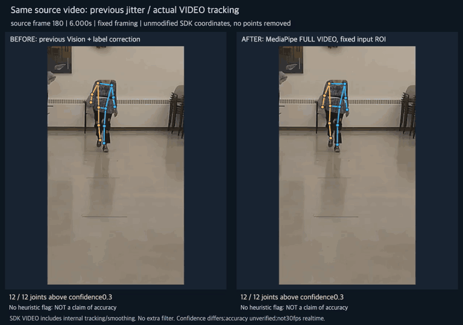
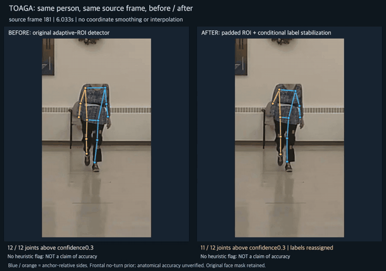
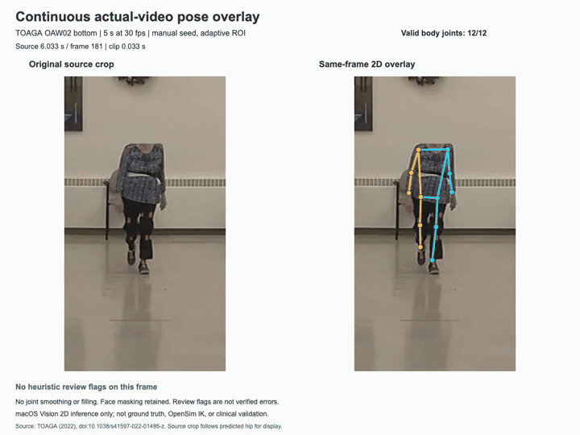
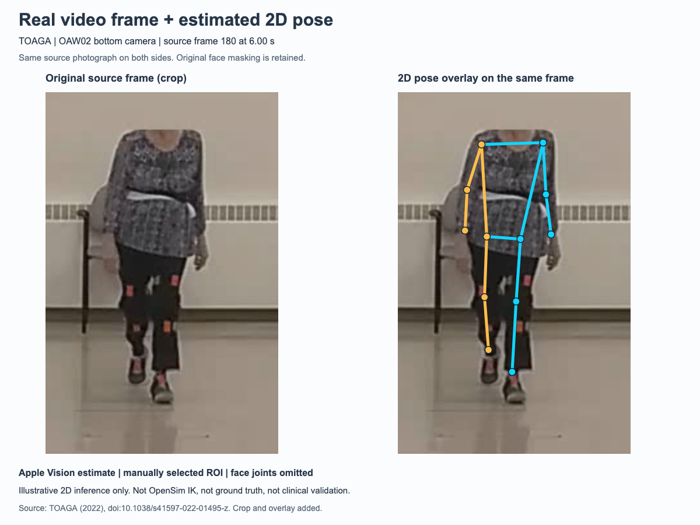
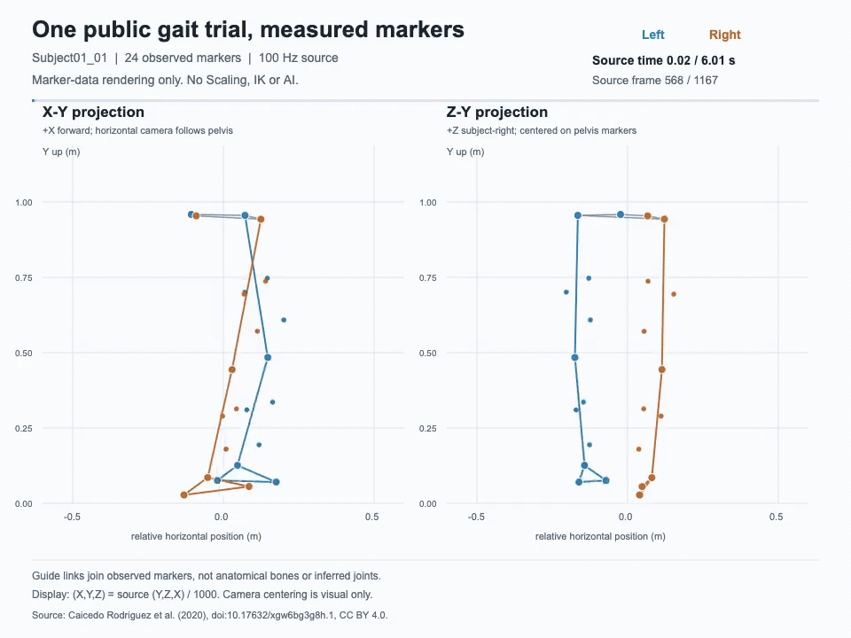

# Public Gait Representation Study

Exploratory research on **retained-walk repeatability, left/right asymmetry, and representation fidelity** using public gait datasets.

**Research work in progress. Not a fall-prediction model, not a validated clinical tool, and not a complete subject-specific OpenSim pipeline.**

## Video-mode tracking comparison: fixed input and display

[](assets/toaga-video-mode-comparison.mp4)

[Full30fps comparison MP4](assets/toaga-video-mode-comparison.mp4) · [Failure-interval QC](assets/toaga-video-mode-qc.png) · [Model, timing, scores and limits](assets/VIDEO_MODE_COMPARISON.md) · [Exact comparison results](results/video_mode_comparison_quality.json)

**이전 버전은 좌표 튐을 해결하지 못했습니다.** 이번에는 MediaPipe 영상 추적 모드와 고정 입력/표시 영역으로 바꿨습니다. 같은150프레임에서 최대 관절 이동93.33→13.90픽셀,50픽셀 초과 이동12→0회입니다. SDK가 보고한12관절 좌표를150프레임 모두 유지했으며 추가 필터·점 제외·보간은 하지 않았습니다. **SDK 내부 추적/평활화는 포함**되며, 신뢰도 척도는 이전 모델과 다르고 해부학적 정확도는 미검증이며 이번 CPU 실행은 실시간30fps가 아닙니다.

## Stabilization comparison: same source frames

[](assets/toaga-stabilization-comparison.mp4)

[Full30fps comparison MP4](assets/toaga-stabilization-comparison.mp4) · [Failures and regressions](assets/toaga-stabilization-qc.png) · [Full variant results](results/stabilization_comparison_quality.json) · [Method, rejected variants and limits](assets/STABILIZATION_COMPARISON.md)

**같은150프레임의 보정 전후 비교입니다.** 검출149→150프레임,12관절 모두 기준 통과116→143프레임, 누락/기준 미달 관절107→11개, 좌우 의심13→1프레임입니다. **큰 좌표 튐은11→10프레임으로 여전히 남고, 일부 프레임은 오히려 악화됐습니다.** 좌표를 평활화하거나 누락을 채워 숨기지 않았습니다. 정면·회전 없는 구간의 첫 프레임 기준 라벨 가정이며 해부학적 좌우 정확도는 미검증입니다. 독립 검증 전 코호트를 늘리지 않습니다.

## Five-second continuous video overlay



[Full 30fps MP4, all150 frames](assets/toaga-continuous-overlay.mp4) · [Failure-inclusive QC frames](assets/toaga-continuous-qc.png) · [Quality results](results/continuous_overlay_quality.json) · [Method and limits](assets/CONTINUOUS_OVERLAY.md)

실제 영상의6~11초 구간을 연속 처리했습니다. **150프레임 중149프레임에서 포즈가 검출됐지만,12관절 모두 기준을 통과한 것은116프레임**입니다. 검출률은 정확도가 아닙니다. 누락·좌우 라벨 불안정·좌표 튐을 숨기거나 보간하지 않았습니다.

**Review required before expansion:**107/1800 joint observations were missing/below0.3 confidence;13 frames had swap-like review flags and11 had large-jump flags. These exploratory flags are not all verified errors. The preview GIF is downsampled;the MP4 preserves every source frame,including the no-pose frame. Manual initial ROI;no clinical validation,ground truth or OpenSim IK.

## Real-video pose overlay



실제 보행 영상의 사진 위에 2D 포즈를 겹친 예시입니다. 왼쪽은 원본 사진, 오른쪽은 같은 사진에 추정 관절을 표시했습니다. 원본 얼굴 가림은 유지했습니다.

This uses the **separate TOAGA public dataset**, source frame180 at6.00s. Pose was estimated on that exact image using macOS Vision with a manually selected region. This is **not the Mendeley marker trial, not the released TOAGA OpenPose CSV, not OpenSim IK and not a validated clinical measurement**.

[Image and method details](assets/TOAGA_OVERLAY.md) · [Exact provenance and coordinates](assets/toaga-overlay-provenance.json)

## Representative measured-marker preview



[Full-rate MP4](assets/marker-preview.mp4) · [Static frame](assets/marker-static.png) · [Source and rendering details](assets/README.md)

One public trial, not a representative clinical cohort result. Lines are visual guides between observed markers, **not anatomical bones, inferred joints or an OpenSim IK solution**. No actual-person video, private data, missing-marker imputation or AI-generated movement is included.

## What is verified

- Public Mendeley dataset audit:44 participants, ages54–87;31 aged65+. Five quality-selected retained walks per person,220 records. The source collected10 walks and kept the best5.
- SPPB is a total score only in the audited files. POMA-G item ratings are available for39 participants. Do not invent SPPB subtests or treat220 walks as220 independent people.
- Subject01_01:602 frames at100Hz,24 observed lower-limb/pelvis markers and30 CGM2.3 angle components. Four wholly absent calibration-marker columns were excluded, not filled.
- Initial OpenSim4.4 table reading preserved61,404 marker/angle values. The later candidate rotation and mm→m conversion preserved43,344 marker-component values with native maximum error0 and matching cross-host numeric digest.
- Proper rotation R maps source(Y,Z,X) into target(X,Y,Z).166,152 marker-pair distances were preserved within floating-point rounding. This is geometry-supported for this trial, not independent laboratory calibration.
- Six generic-model pelvis/ankle candidate connections initialize successfully. Six knee/foot candidates still require placement review;12 segment-tracking markers are not arbitrarily mapped. No candidate is activated for IK.

## What is not verified

Actual anatomical attachment equivalence, external laboratory-axis calibration, subject-specific Scaling, IK accuracy, full-body foundation-model compatibility, AI/clinical validity, prospective falls prediction, literature novelty and institutional ethics determination remain open. Model initialization is not a subject-specific motion result.

The recorded native experiment predates this portable public-code refactor. Node tests and fresh source-data reruns are reported separately; the public Python refactor is not claimed to have been rerun in OpenSim.

## Start here

- [Research scope and limits](docs/RESEARCH_SCOPE.md)
- [Reproduction instructions](docs/REPRODUCIBILITY.md)
- [Evidence and data/coordinate distinctions](docs/VALIDATION.md)
- [Dataset sources and hashes](data/README.md)
- [Publishing/privacy boundaries](docs/PUBLICATION_POLICY.md)
- [Management and update workflow](docs/MANAGEMENT.md)
- [Source citations and licensing boundaries](CITATION.md) and [LICENSES.md](LICENSES.md)

Node20+ is used without external dependencies. Run:

```sh
npm test
node tools/download-datasets.mjs --root ./data-local --dataset mendeley
node scripts/export-single-trial.mjs --zip ./data-local/Mendeley_Gait44_v1/original.zip --out-dir ./runs/export-01
node scripts/validate-marker-axes.mjs --input-dir ./runs/export-01 --out-dir ./runs/geometry-01
```

Use new output folders; scripts refuse to overwrite prior results. Downloaded data, run outputs, model assets and runtime logs stay outside Git.

## Initial exploratory finding, not a clinical conclusion

On the44-person retained-walk dataset, one-way single-walk ICC was0.921 for mean bilateral speed,0.076 for absolute step-time symmetry and0.442 for absolute step-length symmetry. Signed and absolute asymmetry give different results; all prespecified-after-pilot sensitivity combinations are retained rather than selecting the largest ICC. Speed units in these summary files still carry the original source-check caveat.

See the aggregate [pilot](results/exploratory_repeatability.json) and [sensitivity](results/exploratory_sensitivity.json) records for confidence intervals and limitations. Selection, restricted between-person variation, noise floors and model definitions prevent a general clinical interpretation.
